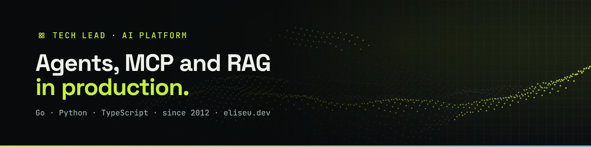

  

<h1 align="center">Olá, eu sou o Eliseu! 👋</h1>

  
  
  
  
  
  
  

  

  

  

---

### 👨‍💻 Sobre Mim

Sou um **Software Developer** com mais de **10 anos de experiência**, especializado em **MicroFrontends**, **arquitetura de sistemas distribuídos** e **engenharia de plataformas**. Tenho foco em construir soluções digitais **escaláveis e de alto desempenho**, transformando desafios complexos em produtos de impacto. Ao longo da minha carreira, já liderei times de desenvolvimento e contribuí para soluções que impactaram **milhões de usuários** em diversos setores.

Tenho paixão por:

- **Frontend:** ReactJS, Angular, VueJS, **Next.js**, SingleSPA, Design Systems
- **Backend:** Node.js (NestJS, Express), PHP (Laravel, Symfony), Python, Java (Spring)
- **Infraestrutura:** AWS, Oracle, Kubernetes, Docker, Terraform, GitHub Actions (CI/CD)
- **Blockchain:** Desenvolvimento de soluções em Bitcoin, Ethereum, Smart Contracts

🎸 Além de tecnologia, sou músico nas horas vagas (teclado, guitarra, baixo, bateria e melódica). Também sou entusiasta de inovação, automação residencial, eletrônica/elétrica e sistemas de CFTV.

🚀 Atualmente estou focado em projetos próprios e também aberto a novas oportunidades, principalmente em inovação com MicroFrontends e aplicações de inteligência artificial em plataformas SaaS.

💬 **Me pergunte sobre:** Arquitetura de Software, MicroFrontends, APIs, Cloud, Sistemas Distribuídos, Blockchain, DevOps, Design Patterns, Segurança e Inteligência Artificial.

📫 **Onde me encontrar:** Nos links acima ☝️ ou no meu [site pessoal](https://eliseu.dev/).

⚡ **Curiosidade:** Amo programação, criptomoedas (especialmente BTC), inovação e música.

---

### 🛠️ Tecnologias e Ferramentas

  

---

### 📈 Minhas Estatísticas

  
  
  

  

---

### 🧠 Métricas de Desenvolvimento

  

> **Nota:** *As linguagens mostradas acima são baseadas apenas nos repositórios públicos.*
